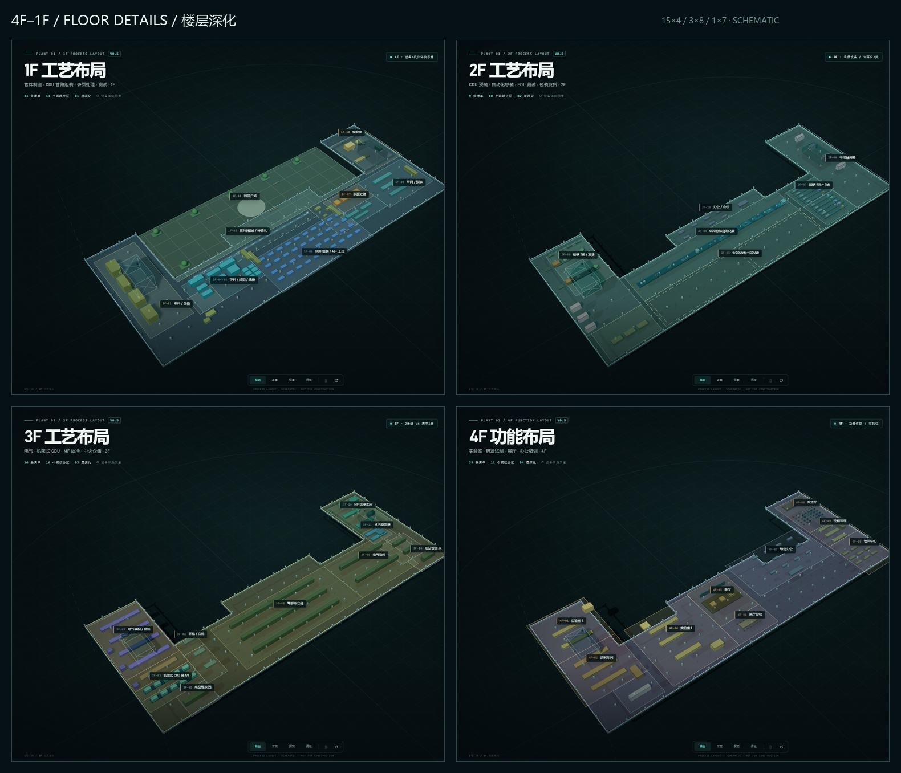
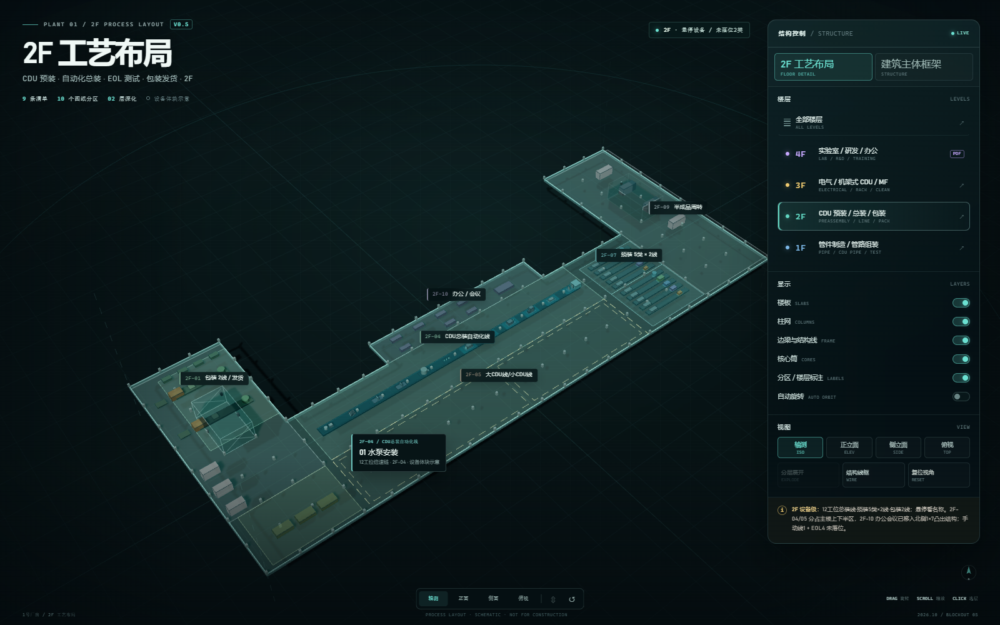

# 1号厂房 · 统一柱网 + 4F–1F 楼层深化 + 2F 设备级 / v0.5

这是建筑主体框架之后的第二轮深化：**4F、3F、2F、1F 四层可切换的楼层布局**。v0.5 先修正结构基线：**1–4F 统一为“主楼 15×4 + 两翼各 3×8 + 北侧 1×7 凸出”**；2F 则把办公会议移到 1×7 凸出区，把主楼上下半区分别留给 CDU 总装自动化线和大/小 CDU 线预留。

打开 [index.html](index.html) 直接查看（Three.js 全部本地化，无需联网）。

---

## 1. 四层现在分别是什么

| 楼层 | 定位 | 本版表达 |
|---|---|---|
| **1F** | 管路重工艺层 | 来料/仓储、下料/成型/焊接、CDU 管路组装、表面处理、环网/预装、实验室、线边缓存、北侧园区广场 |
| **2F** | CDU 预装 / 总装 / 包装 | **设备级**：12 工位总装线、5类×2预装线、2条包装线、成品周转/发货、2F-05 大/小CDU线空框、2F-10 办公会议（1×7凸出区） |
| **3F** | 电气 / 机架式 CDU / MF / 仓储 | 电气装配测试、样件、两条机架式 CDU 线、中央仓储、电气物料、MF 洁净车间、分水器组装、东西成品暂放 |
| **4F** | 研发、试制、展示、办公培训 | 实验室 1/2、试制车间、展厅、展厅会议、综合办公、报告厅、技能训练场、培训中心 |

## 0. 结构基线（v0.5 修正）

- **1–4F 同一轮廓、同一柱网**，不再按楼层画不同体块。
- **主楼**：15 跨 ×4 跨，对应 16×5 根柱线；位于两翼之间。
- **两翼**：各 3 跨 ×8 跨，对应 4×9 根柱线；左右对称。
- **北侧凸出**：1 跨 ×7 跨，对应 2×8 根柱线，位于主楼北侧中部。
- 1F 的北侧开敞区作为 **园区广场**，用低矮铺装平台承接，不把它当成结构楼板。
- 2F 的 **2F-10 办公/会议** 已移入 1×7 凸出区；**2F-04 总装自动化线 + 通道** 占主楼上半区，**2F-05 大/小 CDU 线空框** 占下半区。

### 1F

- 西端高位货架/来料与周转。
- 中西部下料、机加、拔孔、弯管、焊接设备群。
- 第 5 行全自动线用**虚线中心线/半透明条带**表达，避免与第 6–24 行单机重复计列。
- 南侧 CDU 管路组装区约 40+ 工位，用 40 个蓝色工位示意。
- 东端表面处理槽组、环网/预装工作台和玻璃隔断实验室。
- `1F-11` 按最新口径改为 **园区广场**：不再作为“未标注/预留”生产区，使用铺装网格、中央圆形场地、树池/绿化和座椅表达，不布置生产设备。

### 2F（本版设备级）

- **2F-04 CDU总装自动化线**：1 条倍速链，12 个独立工位，占主楼上半区（含通道），按清单顺序为
  `01 水泵安装 → 02 板换安装 → 03 一次侧安装 → 04 二次侧安装 → 05 水箱系统安装 → 06 传感器安装 → 07 保压 → 08 安规测试 → 09 氦质谱检漏 → 10 电气安装 → 11 二次接线 → 12 打点/追溯`。
  每个工位用不同的设备体块表达（泵、板换叠片、管路阀组、水箱、传感器、测试柜、氦检腔、电控柜、线束台、打点机构）。
- **2F-07/08 产品预装**：北、南两个预装区各 5 条线，共 **5类×2线 = 10 条**：水箱系统预装、保温包覆、一次侧预装、二次侧预装、标签制作；每条线有独立头单元和作业位。
- **2F-01 成品包装**：2 条包装线，包含自动缠绕、木箱、托盘/码垛工位。
- **2F-05 大CDU线/小CDU线**：占主楼下半区；下部用两条内嵌虚线空框表达大/小 CDU 线位，不布置设备。原 **2F-06** 小 CDU 线空框已并入 2F-05，不再单独作为分区标签。
- **2F-10 办公/会议**：从主楼中部移到北侧 **1×7 凸出结构**，配套桌椅与会议桌。
- **2F-02/03/09**：成品周转货架、发货缓冲、东端半成品周转货架。
- **悬停设备体块可查看名称、所属区和设备组**；悬停提示只在 2F 楼层模式启用。
- **清单另有手动总装 1 条、EOL/FATA 4 条，图纸未定位；本层只用提示条和面板说明，没有强行放设备。**

### 3F

- 西翼电气装配/测试、CDU 样件、两条机架式 CDU 组装测试线。
- 中部零部件仓储和电气物料仓储，形成贯通的仓储脊柱。
- 东翼 MF 洁净车间（玻璃围护）、分水器组装、氦检相关设备、物料暂放及东西成品暂放。
- 图纸上的两条机架式 CDU 线在清单里只按 1 套记录，这一差异在页面提示条中保留。

### 4F

- 4F-01 实验室 2、4F-02 试制车间、4F-04 实验室 1（含环境/振动/材料测试类体块）。
- 4F-05 展厅、4F-06 展厅会议、4F-07 综合办公。
- 4F-08 报告厅、4F-09 技能训练场、4F-10 培训中心。
- 4F 分区来自当前 `新工厂图纸_AI结构化描述.json` 的 4F-01–4F-11（4F-11 为辅助核心，无独立矩形），并按 4F 平面范围归一化到楼板；设备按清单类别做功能体块。
- 4F 只做“功能与空间关系”，不代表实验室工艺设备最终机位。

## 2. 交互

- **模式**
  - `1F/2F/3F/4F 工艺布局`：切换当前楼层，隐藏其它楼层，显示分区、设备体块和标签。
  - `建筑主体框架`：回到四层楼板、柱网、边梁、核心筒和屋面框架。
- **楼层行**：4F/3F/2F/1F 分别进入对应楼层深化；“全部楼层”回到建筑主体框架。
- **视图**：轴测 / 正立面 / 侧立面 / 俯视；每层自动换算为该楼层标高。
- **拖拽**旋转、**滚轮**缩放、**右键拖拽**平移。
- **2F 设备悬停**：鼠标移到总装线工位、预装线或包装线上，显示设备名称/工位顺序/所属分区；移出即隐藏。
- **显示**：楼板、柱网、边梁、核心筒、分区/楼层标注、自动旋转。
- **分层展开**只在建筑框架模式生效。
- **结构线框**：切换结构体线框表达。
- 楼层模式使用短柱代替通高柱，便于查看设备/分区；柱网开关可控制短柱显隐。

## 3. 建模边界与假设

- 楼层分区来自 `bbox_norm_approx`，是相对定位，不是实测轴线。
- 柱网按 **15×4 / 3×8 / 1×7** 的跨数关系重建，柱距/梁截面仍不是实测值。
- 设备体块是**代表性布置**，不是厂家模型，也不是施工机位。
- **2F 设备级是“设备体块级”**：12 个工位、10 条预装线、2 条包装线均为示意几何，不代表厂家最终外形/接口/占地。
- 1F 第 5 行整线与第 6–24 行设备可能是重复计列，本页不把它们叠成两套实体。
- 2F 手动线/EOL 未落位；3F 两条机架式 CDU 线与清单 1 套存在数量口径差异。
- 4F 房间矩形按 4F 自身范围归一化，因此和 2F/3F 的绝对分区比例不完全可比。
- `1F-11` 的园区广场为景观/场地示意，铺装、绿化和座椅不代表最终景观设计。
- 层高、柱距、板厚、核心筒尺寸、楼板开洞仍未标定。
- 4F 屋顶/女儿墙不在楼层模式显示；建筑框架模式才显示屋面框架。

**本页不能用于施工、面积、结构、消防或机电核算。**

## 4. 文件

| 文件 | 内容 |
|---|---|
| `index.html` | 页面结构与 UI |
| `style.css` | 深色技术界面、模式面板、分区标签和响应式布局 |
| `app.js` | 四层建筑框架 + 4F–1F 分区/设备/标签/相机/交互 + 2F 设备悬停 |
| `preview-all-floors.png` | 四层总览拼图 |
| `preview.png` | 1F 工艺布局 |
| `preview-2f.png` | 2F 设备级布局 |
| `preview-2f-top.png` | 2F 俯视：2F-04/05/10 重排关系 |
| `preview-2f-equipment.png` | 2F 设备悬停/工位名称示例 |
| `preview-3f.png` | 3F 工艺布局 |
| `preview-4f.png` | 4F 功能布局 |
| `preview-frame.png` | 建筑主体框架透视 |
| `preview-frame-top.png` | 统一柱网俯视：15×4 / 3×8 / 1×7 |
| `vendor/three.global.js` | 本地 Three.js |
| `vendor/orbit-controls.global.js` | 本地轨道控制 |

## 5. 已知待确认

- 1F：第 5 行整线 / 第 6–24 行单机的关系；1F-06 工位数。`1F-11` 已按园区广场处理，不再作为预留生产区。
- 2F：清单第 39 行“传单器安装”按“传感器安装”理解，需确认；12 工位顺序与线体方向（图上箭头与包装区位置仍有冲突）；手动总装线和 4 条 EOL 的物理位置；2F-05 大/小 CDU 空框是否投入使用；设备最终外形与接口。
- 3F：两条机架式 CDU 线与清单 1 套的换算；MF 洁净等级、组装/氦检顺序。
- 4F：实验室/研发/试制与 1F 实验室、4F CNAS 的职责边界；设备最终机位。
- 既有 `设备数据映射 v0.1` 仍以 1F–3F 底稿为主；4F 的设备/分区落位需要同步回填。

## 6. 下一步

1. 先确认统一柱网、2F 的 12 工位顺序、线体方向和 2F-05 空框位置；
2. 用手动线/EOL 的实际定位补齐 2F 测试段；
3. 把 2F 体块继续替换成厂家设备轮廓（先水泵、板换、水箱、氦检、EOL）；
4. 再把同样的设备级做法推进到 3F 机架式 CDU / MF 洁净间；
5. 同步修正设备数据底稿的 4F 分区与设备落位。

## 7. 来源

- `新工厂最新方案-Model.pdf`
- `新工厂图纸_AI结构化描述.json`（当前包含 4F–1F，共 51 个分区）
- `新工厂图纸_AI结构化解读.md`
- `产品产线规划及设备清单V2.2（厂家规划方案）.xlsx`

日期：2026-10-25  
版本：v0.5 / 4F–1F FLOOR DETAILS + UNIFIED GRID + 2F EQUIPMENT DETAIL
